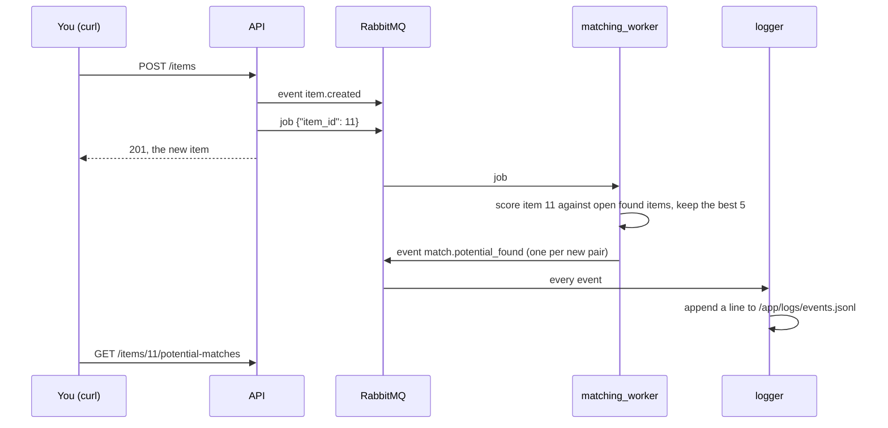

# Walkthrough: from a lost item to a confirmed match

This takes about 20 minutes. You start a fresh stack with the demo data, then play two people:

- **Alex**, a student who lost an umbrella. Alex logs in, posts it with a photo, looks at what the app suggests, and
  confirms the match.
- **The admin**, who finds an item with no suggestions and runs a match search for it.

Then you read the metrics those actions produced. The whole time, other windows show the workers, the event log and
the Grafana dashboard reacting. Between them, the steps use all four services: Postgres, RabbitMQ, the S3 object
store and Prometheus. Each step says what to run, what you should see, and why. Some steps ask you to predict the
result before you run the command.

## The idea in one picture


(if this chart does not appear as a graph, you maid need to install a `mermaid` extension in your IDE)

Three things to keep in mind:

1. **Posting an item doesn't do the matching.** The API saves the item, puts a job on RabbitMQ and answers right
   away. The matching worker does the scoring a moment later.
2. **A suggestion is a lost/found pair with a score.** For each distinct word in the item's description that also
   appears in the other description, the pair gets 0.25. Repeats of a word add 0.1. Common words like "the", "with",
   "lost" and "found" don't count. Only `open` items of the other type are considered, and each item keeps its best 5.
3. **Every step publishes an event**, and the `logger` service writes each event as one line of
   `/app/logs/events.jsonl`. That file is the record of what happened.

## Before you start

- Docker with compose, `curl` and `jq`.
- **bash.** The commands use bash syntax. If your terminal runs fish, type `bash` first.
- In `.env.local`:
  - `ADMIN_DISPLAY_NAME` and `ADMIN_PASSWORD` set. That's the admin you use in step 8.
  - `DEMO_USER_PASSWORD` set to something 6 to 72 characters long. Every demo user signs in with it.
  - Storage settings that work (see `.env.local.example`).
- Run everything from the repo root.

## 1. Start from a clean slate

> **Warning:** `--volumes` deletes the database, the queue, the event log and stored photos. The walkthrough needs
> it because demo data is only created in a brand-new database.

```bash
docker compose --env-file .env.local down --volumes
docker compose --env-file .env.local up -d --build --wait
curl -s http://localhost:8000/api/v1/health | jq -c
```

You should see:

```
{"status":"ok","checks":{"database":"ok"}}
```

`--wait` returns once the API reports healthy. While it started, the API did all of this:

- created the admin, 3 demo users, 3 locations and 10 items
- matched the two water bottles
- queued one matching job, for the lost black backpack

## 2. Open windows to watch

**Terminal 2: the event log**, showing every event as one compact line:

```bash
docker compose --env-file .env.local exec -T logger tail -n +1 -f /app/logs/events.jsonl \
  | jq -c '{type: .routing_key, source: .event.source, payload: .event.payload}'
```

The three suggestions the worker made for the backpack at startup should already be there:

```
{"type":"match.potential_found","source":"matching-worker","payload":{"lost_item_id":1,"found_item_id":2,"score":1.5}}
{"type":"match.potential_found","source":"matching-worker","payload":{"lost_item_id":1,"found_item_id":6,"score":0.25}}
{"type":"match.potential_found","source":"matching-worker","payload":{"lost_item_id":1,"found_item_id":8,"score":0.25}}
```

**Terminal 3: the workers and the notifier:**

```bash
docker compose --env-file .env.local logs -f matching_worker image_worker notifier
```

Look for these lines:

- `INFO Item 1: 3 suggestions, 3 new` from the matching worker.
- A `Would notify for match.potential_found` line from the notifier for each suggestion. The notifier doesn't send
  anything yet; it only logs what it would send.

The image worker only says `Waiting for jobs on jobs.image_processor` until step 6.

**A browser: the dashboard.** Open http://localhost:3000, sign in with `GRAFANA_USER` and `GRAFANA_PASSWORD` from
`.env.local`, and open the **Seekr** dashboard (Dashboards, then Seekr). It's mostly empty for now; step 9 comes
back to it.

Keep all three open. Run everything else in terminal 1.

## 3. Set up terminal 1

```bash
API=http://localhost:8000/api/v1
JSON='Content-Type: application/json'
login() {
  curl -s -X POST "$API/auth/login" --data-urlencode "username=$1" --data-urlencode "password=$2" | jq -r .access_token
}
env_value() { grep "^$1=" .env.local | cut -d= -f2-; }
ADMIN_DISPLAY_NAME=$(env_value ADMIN_DISPLAY_NAME)
ADMIN_PASSWORD=$(env_value ADMIN_PASSWORD)
DEMO_USER_PASSWORD=$(env_value DEMO_USER_PASSWORD)
```

Nothing prints yet. This only defines a `login` helper and copies three settings out of `.env.local`. If you put
quotes around those values in `.env.local`, set the three variables by hand instead.

`login` takes a display name and a password, and prints that account's token. Steps 5 and 8 use it. Check that it
works with the admin from `.env.local`:

```bash
login "$ADMIN_DISPLAY_NAME" "$ADMIN_PASSWORD" | cut -c1-20
```

```
eyJhbGciOiJIUzI1NiIs
```

Every token starts like this. If you get `null` instead, the name or password doesn't match an account. See the last
section.

## 4. Look around (no login needed)

Browsing is public:

```bash
curl -s "$API/items?limit=50" | jq -c '.[] | {id, name, type, status}'
```

```
{"id":10,"name":"Umbrella","type":1,"status":"open"}
{"id":9,"name":"Grey hoodie","type":0,"status":"open"}
{"id":8,"name":"Car keys","type":1,"status":"open"}
{"id":7,"name":"Wireless earbuds","type":0,"status":"open"}
{"id":6,"name":"Blue lanyard","type":1,"status":"open"}
{"id":5,"name":"Student ID card","type":0,"status":"open"}
{"id":4,"name":"Water bottle","type":1,"status":"matched"}
{"id":3,"name":"Silver water bottle","type":0,"status":"matched"}
{"id":2,"name":"Black backpack","type":1,"status":"open"}
{"id":1,"name":"Black backpack","type":0,"status":"open"}
```

Newest first. `type` 0 is lost and 1 is found. The two water bottles (3 and 4) are already matched to each other.

Now the suggestions for item 1, the lost black backpack:

```bash
curl -s "$API/items/1/potential-matches" | jq -c '.[] | {found_item_id, score}'
```

```
{"found_item_id":2,"score":1.5}
{"found_item_id":6,"score":0.25}
{"found_item_id":8,"score":0.25}
```

> **Think it through:** Without the common words, the backpack's description is *black, backpack, laptop, sleeve,
> red, keychain, zipper, left, study, table, second, floor*.
>
> - The found backpack (2) shares six of them (black, backpack, red, keychain, zipper, table): 6 × 0.25 = 1.5.
> - The lanyard (6) only shares "floor", and the car keys (8) only share "black".
> - The umbrella (10) shares nothing, so it isn't listed. A pair that scores 0 is never kept.

## 5. Log in as Alex and post a lost item

```bash
ALEX=$(login alex-rivera "$DEMO_USER_PASSWORD")
echo "${ALEX:0:20}..."
curl -s $API/auth/me -H "Authorization: Bearer $ALEX" | jq -c '{id, display_name, roles: [.roles[].name]}'
```

The token starts with `eyJ`, and `/auth/me` shows who it belongs to:

```
{"id":2,"display_name":"alex-rivera","roles":["user"]}
```

If `$ALEX` is `null`, the password was wrong. See the last section.

Alex lost a navy umbrella near the library entrance.

> **Predict:** Item 10 is a found "Umbrella" described as *"Navy blue compact umbrella with a wooden handle, found in
> the umbrella stand by the main entrance."* Which items will be suggested for Alex's post, and which will come first?

```bash
LOST=$(curl -s -X POST $API/items -H "$JSON" -H "Authorization: Bearer $ALEX" \
  -d '{"name":"Navy umbrella","description":"Navy blue compact umbrella with a wooden handle, left near the main entrance of the library","type":0,"location_id":1}' \
  | jq .id)
echo "new lost item: $LOST"
```

```
new lost item: 11
```

Now look at the other windows:

- **Terminal 3:** `INFO Item 11: 2 suggestions, 2 new`.
- **Terminal 2:** the post, then the two suggestions the worker made a moment later:

```
{"type":"item.created","source":"campus-seekr-api","payload":{"item_id":11}}
{"type":"match.potential_found","source":"matching-worker","payload":{"lost_item_id":11,"found_item_id":10,"score":2.0}}
{"type":"match.potential_found","source":"matching-worker","payload":{"lost_item_id":11,"found_item_id":6,"score":0.25}}
```

Ask the API for them. The `sleep` gives the worker a moment, in case you pasted straight through:

```bash
sleep 2
curl -s "$API/items/$LOST/potential-matches" | jq -c '.[] | {found_item_id, score}'
```

```
{"found_item_id":10,"score":2.0}
{"found_item_id":6,"score":0.25}
```

> **Check:** The umbrella shares eight words (navy, blue, compact, umbrella, wooden, handle, main, entrance):
> 8 × 0.25 = 2.0. The lanyard only shares "blue". "With", "the" and "near" don't count.

If the list is empty, the worker hasn't finished yet. Run the command again. If it stays empty, look at terminal 3.

## 6. Add a photo to Alex's item

Photos never pass through the API. Alex asks the API for an upload address, sends the file straight to the object
store, and tells the API it's done. The image worker then checks the file, shrinks it and stores the finished photo.

First make a sample photo. This runs Python inside the API container, so you don't need anything installed:

```bash
docker compose --env-file .env.local exec -T app python -c "import io, sys; from PIL import Image; b = io.BytesIO(); Image.new('RGB', (1600, 1200), 'navy').save(b, 'JPEG'); sys.stdout.buffer.write(b.getvalue())" > photo.jpg
```

That's a plain 1600 × 1200 navy rectangle. A JPEG or PNG of your own works too; use its name instead of `photo.jpg`.

Ask for an upload address:

```bash
UPLOAD=$(curl -s -X POST "$API/items/$LOST/images" -H "Authorization: Bearer $ALEX")
UPLOAD_ID=$(echo "$UPLOAD" | jq -r .upload_id)
echo "$UPLOAD" | jq -c '{upload_id, status, expires_in}'
echo "$UPLOAD" | jq -r .upload_url | cut -d/ -f1-3
```

```
{"upload_id":"33bde0b6-48c8-4005-8f75-4324ea6b9b05","status":"awaiting_upload","expires_in":600}
http://localhost:9000
```

Your `upload_id` will differ. `upload_url` is a presigned URL. It points at the object store, not the API (the
second line is its address; with the local store, `http://localhost:9000`), and carries its own signature, so the next request needs no token. It stops
working after `expires_in` seconds.

Send the file to the store, then tell the API:

```bash
curl -s -X PUT --upload-file photo.jpg "$(echo "$UPLOAD" | jq -r .upload_url)" -o /dev/null -w '%{http_code}\n'
curl -s -X POST "$API/items/$LOST/images/$UPLOAD_ID/complete" -H "Authorization: Bearer $ALEX" -o /dev/null -w '%{http_code}\n'
```

```
200
202
```

The 200 comes from the object store. The 202 comes from the API: it put a job on RabbitMQ and answered without
waiting. Now look at the other windows:

- **Terminal 3:** `INFO Stored items/11/<upload_id>/photo.jpg (image/jpeg, 30629 bytes in)` from the image worker.
- **Terminal 2:** `{"type":"image.processed","source":"image-worker","payload":{...,"status":"ready",...}}`.

Check the result:

```bash
sleep 2
curl -s "$API/items/$LOST/images/$UPLOAD_ID" | jq -c '{status, reject_reason}'
curl -s -o fetched.jpg -w '%{http_code} %{content_type}\n' "$(curl -s "$API/items/$LOST" | jq -r .photo_url)"
docker compose --env-file .env.local exec -T app python -c "import io, sys; from PIL import Image; print(Image.open(io.BytesIO(sys.stdin.buffer.read())).size)" < fetched.jpg
```

```
{"status":"ready","reject_reason":null}
200 image/jpeg
(1280, 960)
```

> **Check:** The item now has a `photo_url`, another presigned URL, this time for downloading. The worker shrank the
> photo to fit 1280 pixels on its longest side and re-encoded it, so `fetched.jpg` is much smaller than `photo.jpg`
> (compare them with `ls -l photo.jpg fetched.jpg`). Open `fetched.jpg` in an image viewer to see it.

Now try to break it by sending a text file instead:

```bash
echo "not a photo" > note.txt
UPLOAD=$(curl -s -X POST "$API/items/$LOST/images" -H "Authorization: Bearer $ALEX")
UPLOAD_ID=$(echo "$UPLOAD" | jq -r .upload_id)
curl -s -X PUT --upload-file note.txt "$(echo "$UPLOAD" | jq -r .upload_url)" -o /dev/null -w '%{http_code}\n'
curl -s -X POST "$API/items/$LOST/images/$UPLOAD_ID/complete" -H "Authorization: Bearer $ALEX" -o /dev/null -w '%{http_code}\n'
sleep 2
curl -s "$API/items/$LOST/images/$UPLOAD_ID" | jq -c '{status, reject_reason}'
curl -s "$API/items/$LOST" | jq '.photo_url != null'
```

```
200
202
{"status":"rejected","reject_reason":"text/plain is not an allowed image type"}
true
```

> **Why did the store take it?** The store accepts whatever bytes it's given; checking them is the worker's job, and
> it looks at the bytes themselves, not the file name. Terminal 3 shows the rejection, and terminal 2 gets an
> `image.processed` event with `"status":"rejected"`. The last line shows the item kept its good photo: a rejected
> upload never replaces it.

## 7. Confirm the match

Alex recognises item 10 as their umbrella:

```bash
FOUND=$(curl -s "$API/items/$LOST/potential-matches" | jq '.[0].found_item_id')
echo "top suggestion: $FOUND"
MATCH=$(curl -s -X POST $API/matches -H "$JSON" -H "Authorization: Bearer $ALEX" \
  -d "{\"lost_item_id\":$LOST,\"found_item_id\":$FOUND}" | jq .id)
echo "match: $MATCH"
curl -s "$API/items/$LOST" | jq -c '{id, name, status}'
curl -s "$API/items/$FOUND" | jq -c '{id, name, status}'
```

```
top suggestion: 10
match: 2
{"id":11,"name":"Navy umbrella","status":"matched"}
{"id":10,"name":"Umbrella","status":"matched"}
```

This is match 2 because match 1 is the water bottles. In the other windows:

- **Terminal 2:** `{"type":"match.confirmed",...,"payload":{"match_id":2,"lost_item_id":11,"found_item_id":10}}`
- **Terminal 3:** a `Would notify for match.confirmed` line from the notifier.

Now look at the suggestions again:

```bash
curl -s "$API/items/$LOST/potential-matches" | jq -c
```

```
[]
```

> **Why empty?** The suggestions are still stored. A pair is only shown while both of its items are `open`, because
> `POST /matches` would refuse it otherwise. Try matching the same pair again:

```bash
curl -s -X POST $API/matches -H "$JSON" -H "Authorization: Bearer $ALEX" \
  -d "{\"lost_item_id\":$LOST,\"found_item_id\":$FOUND}" | jq -c '.error | {code, detail}'
```

```
{"code":"ITEM_NOT_OPEN","detail":"item 11 is matched and cannot be matched"}
```

## 8. Log in as the admin and run a match search

```bash
ADMIN=$(login "$ADMIN_DISPLAY_NAME" "$ADMIN_PASSWORD")
curl -s $API/auth/me -H "Authorization: Bearer $ADMIN" | jq -c '{display_name, roles: [.roles[].name]}'
```

```
{"display_name":"<your ADMIN_DISPLAY_NAME>","roles":["admin"]}
```

Item 5 is a lost student ID card. Startup only ran matching for the backpack, so the ID card has no suggestions yet:

```bash
ID_CARD=$(curl -s "$API/items?q=student&type=0" | jq '.[0].id')
curl -s "$API/items/$ID_CARD/potential-matches" | jq -c
```

```
[]
```

Only an admin can start a search by hand. First check that nobody else can, with no token and then as Alex:

```bash
curl -s -X POST "$API/items/$ID_CARD/match-search" | jq -c '.error.code'
curl -s -X POST "$API/items/$ID_CARD/match-search" -H "Authorization: Bearer $ALEX" | jq -c '.error | {code, detail}'
```

```
"UNAUTHENTICATED"
{"code":"FORBIDDEN","detail":"requires one of: admin"}
```

That's a 401 with no token (the API doesn't know who you are) and a 403 for Alex (it knows, and the answer is no).

> **Predict:** The ID card was *"in a clear plastic holder on a blue lanyard, probably dropped near the printers on
> the first floor."* Which found item will come out on top? Will the umbrella (item 10) be suggested?

Now run it as the admin:

```bash
curl -s -X POST "$API/items/$ID_CARD/match-search" -H "Authorization: Bearer $ADMIN" | jq -c
```

```
{"item_id":5,"status":"queued"}
```

That's a 202: the job is queued, not finished. Terminal 3 then shows `INFO Item 5: 1 suggestions, 1 new`. Check the
result:

```bash
sleep 2
curl -s "$API/items/$ID_CARD/potential-matches" | jq -c '.[] | {found_item_id, score}'
```

```
{"found_item_id":6,"score":2.0}
```

> **Check:** The blue lanyard (6) shares eight words: card, clear, holder, blue, lanyard, printers, first, floor. The
> umbrella shares "blue" too, but it's matched now, so the worker skipped it.

A search for an item that can't be matched is refused:

```bash
curl -s -X POST "$API/items/$LOST/match-search" -H "Authorization: Bearer $ADMIN" | jq -c '.error | {code, detail}'
```

```
{"code":"ITEM_NOT_OPEN","detail":"item 11 is matched and cannot be matched"}
```

## 9. Read the metrics

The API counts what it does, and Prometheus reads those counts every 15 seconds. Start with the raw counts, which
the API serves at `/metrics/`:

```bash
curl -s $API/metrics/ | grep -E '^seekr_(items_posted|matches_confirmed)_total'
```

```
seekr_items_posted_total{type="lost"} 1.0
seekr_items_posted_total{type="found"} 0.0
seekr_matches_confirmed_total 1.0
```

> **Think it through:** Only Alex's umbrella and its match were counted. The 10 demo items and the water-bottle match
> were written straight to the database at startup, not posted through the API. These counters also go back to 0
> whenever the API container restarts.

Every request is counted too, labelled with its method, route and status:

```bash
curl -s $API/metrics/ | grep '^seekr_requests_total{.*route="/items/{item_id}/potential-matches"'
```

```
seekr_requests_total{method="GET",route="/items/{item_id}/potential-matches",status="200"} 6.0
```

Your count will differ. Notice the route is the template, `/items/{item_id}/potential-matches`, not
`/items/11/potential-matches`. All items share one line instead of each item adding a new one forever.

Now go back to the **Seekr** dashboard in the browser. It refreshes every 30 seconds, so give it a minute after your
last command:

- **Request rate:** a rise while you were running steps 4 to 8.
- **Error rate:** not zero. Steps 7 and 8 caused 401, 403 and 409 responses on purpose, and this panel counts every
  4xx and 5xx.
- **Items posted:** a `lost` line at about 1 for the five minutes after you posted the umbrella, and `found` at 0.
- **Matches confirmed:** about 1 for the five minutes after Alex confirmed the match.

Prometheus has its own page at http://localhost:9090. Type `seekr_items_posted_total` there to see the stored values
behind the panel.

## 10. Optional: undo the match

Unmatching puts both items back to `open`, which automatically queues matching for both:

```bash
curl -s -o /dev/null -w '%{http_code}\n' -X DELETE "$API/matches/$MATCH" -H "Authorization: Bearer $ALEX"
curl -s "$API/items/$LOST" | jq -c '{id, name, status}'
sleep 2
curl -s "$API/items/$LOST/potential-matches" | jq -c '.[] | {found_item_id, score}'
```

```
204
{"id":11,"name":"Navy umbrella","status":"open"}
{"found_item_id":10,"score":2.1}
{"found_item_id":6,"score":0.25}
```

What to notice:

- **Terminal 3** shows `Item 11: 2 suggestions, 0 new` and `Item 10: 2 suggestions, 1 new`.
- **Terminal 2** gets only one new `match.potential_found`, for the ID card and the umbrella (5 → 10). Pairs that
  were already suggested aren't announced again, so nobody is notified twice. The umbrella couldn't be suggested for
  the ID card while it was matched, so that pair really is new.
- **Why 2.1 now?** The found umbrella's re-run scored the pair from its own description, where "umbrella" appears
  twice. The repeat adds 0.1. A pair's score comes from whichever item's run scored it last.

## What you just checked

| Step | What it shows |
|---|---|
| 1, 4 | The stack starts, browsing is public, and the demo data and startup matching ran |
| 5 | Posting an item queues matching on RabbitMQ. The worker scores only `open` items of the other type, and common words don't count |
| 6 | Photos go straight to the object store with presigned URLs, never through the API. `/complete` returns 202, and the image worker checks, shrinks and stores the photo, or rejects a file that isn't an image |
| 7 | Confirming a match sets both items to `matched`, hides their suggestions, and blocks matching them again (409) |
| 8 | `match-search` is admin-only (401 with no token, 403 for a user, 202 for the admin) and refuses closed items (409) |
| 9 | The API exposes request counts by route template plus its own counters, Prometheus stores them, and Grafana graphs them |
| 10 | Reopening items re-runs matching without repeating notifications |
| 2 | Every one of these left a line in `/app/logs/events.jsonl`, written by the logger service |

## Cleaning up

Stop terminals 2 and 3 with Ctrl-C. Then either keep the data or delete everything:

```bash
docker compose --env-file .env.local down            # keeps the data
docker compose --env-file .env.local down --volumes  # deletes it all
```

## If something doesn't match

- **`up --wait` fails with `container campus-seekr-notifier-1 has no healthcheck configured`:** older Docker Compose
  versions refuse `--wait` for the workers, whose health check is turned off. Start the stack in two steps instead:
  `docker compose --env-file .env.local up -d --build --wait gateway app`, then
  `docker compose --env-file .env.local up -d --build`.
- **curl returns `{"error":{"code":"SERVICE_UNAVAILABLE",...}}`:** the gateway couldn't reach the API. Run
  `docker compose --env-file .env.local ps`. If `app` is `healthy`, recreate the gateway:
  `docker compose --env-file .env.local up -d --force-recreate gateway`.
- **`login` prints `null`:** wrong name or password. Call it with a real name and password, like
  `login "$ADMIN_DISPLAY_NAME" "$ADMIN_PASSWORD"`; running `login` with nothing after it, or pasting the `curl` line
  from inside it on its own, sends an empty login. Accounts keep the password they were created with:
  - **The admin** has the `ADMIN_PASSWORD` from when the API first created it. Editing `.env.local` later doesn't
    change it.
  - **The demo users** have the `DEMO_USER_PASSWORD` from when the database was created. If that was empty, there
    are no demo users; start again from step 1.
- **A worker's log shows `ConnectionClosedByBroker ... reason 'shutdown'`:** RabbitMQ was stopped or restarted while
  that worker was connected. The workers don't reconnect on their own, so it stopped. Messages wait in its queue
  meanwhile. Run `docker compose --env-file .env.local up -d` to start any service that stopped, then check
  `docker compose --env-file .env.local ps -a`.
- **The item list is empty, or the ids are different:** the database wasn't new. Go back to step 1, including
  `--volumes`, with `DEMO_USER_PASSWORD` set.
- **Suggestions never show up:** `docker compose --env-file .env.local ps matching_worker` should show it running.
  Terminal 3 shows any error.
- **The photo `PUT` fails with `Could not resolve host: storage`:** the upload URL was signed for the address the
  containers use, which your machine can't reach. Set `S3_PUBLIC_ENDPOINT_URL=http://localhost:9000` in `.env.local`
  and run `docker compose --env-file .env.local up -d` to restart the API with it.
- **A photo stays `processing`:** the image worker didn't finish the job.
  `docker compose --env-file .env.local ps image_worker` should show it running; terminal 3 shows any error.
- **A dashboard panel says "No data":** Prometheus scrapes every 15 seconds and the panels look at 5-minute windows,
  so wait a minute. If it stays empty, http://localhost:9090/targets should show the `seekr-app` target as `UP`.
- **Terminal 2 stays empty, or the logger exited with `Cannot write /app/logs/events.jsonl`:** the event log volume
  is from an older image. Step 1's `down --volumes` recreates it.
