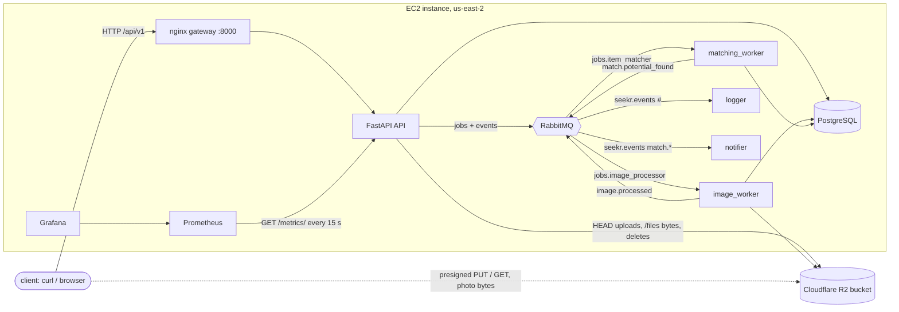
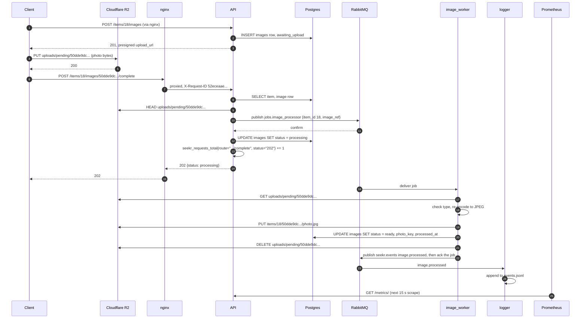

# Architecture

Campus Seekr is a lost-and-found API for a campus. People post lost or found items with a photo, the system
suggests lost/found pairs, and the owners confirm a match. This page covers what runs where, the four services
and how the app uses each, and one request traced through all four.

## What runs where

Everything except the object store is the `compose.yml` stack, unchanged, on one EC2 instance. Only `.env.local`
on the instance differs from a laptop run.

| | Deployed run (2026-10-22) |
|---|---|
| Compute | Amazon EC2 `i-06fc8267b6b2af6b2`, c7i-flex.large (2 vCPU, 3.7 GiB), us-east-2c, Ubuntu 26.04.1, Docker 29.1.3, Compose 2.40.3, 14 GB root volume |
| Front door | nginx 1.27.4 (`gateway`), published on port 8000 of the instance's public IPv4 address. Plain HTTP, no TLS |
| Relational | PostgreSQL 16.6 container (`db`), data on the `seekr_data` volume |
| Messaging | RabbitMQ 3.13.7 container (`broker`), data on the `brokerdata` volume |
| Object storage | Cloudflare R2 bucket `deployed-project-bucket`, through its S3 API |
| Metrics | Prometheus v3.2.1 (`prometheus`, port 9090) scraping the API every 15 s; Grafana 11.5.2 (`grafana`, port 3000) |
| Deployed code | commit `f5cea42a4bb1b0873efe79a19a8fad3667fa4d63`, built on the instance by `adapter_deploy` (see `evidence/ci-and-deploy.md`) |

If the diagram doesn't render, `docs/Architecture.drawio.html` in the repository has the same services.

## The four services

| Category | Interface | In this system | Where the code is |
|---|---|---|---|
| Object storage | S3 API, SigV4, `endpoint_url` from `S3_ENDPOINT_URL` | Item photos: the API issues a presigned PUT, the client uploads straight to R2, the image worker re-encodes the upload and writes `items/{id}/{upload_id}/photo.jpg`, and reads return a presigned GET. Files (receipts and other proof of ownership) go through `/files`, which checks them before writing `users/{id}/files/{upload_id}.{ext}`. Each object's key, detected type and size are rows in `images` or `files` | `app/ports/storage.py` (the only module that talks to the store), `app/routers/images.py`, `app/routers/files.py`, `app/image_worker.py` |
| Relational data | PostgreSQL wire protocol, SQLAlchemy + psycopg2 | 9 tables: `users`, `roles`, `user_roles`, `locations`, `items`, `matches`, `potential_matches`, `images`, `files`. Foreign keys with `ON DELETE RESTRICT` or `CASCADE`, unique pairs and check constraints, all enforced by Postgres (`evidence/transcripts/01-relational-postgres.txt`, part B) | `app/database/models.py`, `app/crud.py` |
| Messaging | AMQP 0-9-1, pika | Two durable work queues: `jobs.image_processor` (photo processing, 202 from `/complete`) and `jobs.item_matcher` (scoring a new item against open items). One durable topic exchange, `seekr.events`, fans events out to `events.logger` (everything) and `events.notifier` (match events). Persistent messages, publisher confirms, manual acks after the work, prefetch 1 | `app/messaging.py`, the four workers |
| Metrics | Prometheus exposition format | `seekr_requests_total{method, route, status}`, with `route` the matched template, plus the domain counters `seekr_items_posted_total{type}` and `seekr_matches_confirmed_total`. Grafana's provisioned "Seekr" dashboard has request rate, error rate, items posted and matches confirmed | `app/api.py` (middleware), `app/metrics.py`, `monitoring/` |

The code that talks to each service is the same locally and on AWS. There is no `if cloud:` branch anywhere in the
data path. What changes is in `.env.local`:

- `S3_ENDPOINT_URL`, `S3_BUCKET`, `AWS_DEFAULT_REGION` and the key pair point at R2 instead of the local RustFS
  container.
- `S3_PUBLIC_ENDPOINT_URL` is empty on R2. Locally it is `http://localhost:9000`, because the client and the API
  reach the local store at different addresses and the host is part of a presigned URL's signature. On R2 both
  sides use the same HTTPS address.

The local RustFS container (`storage`) still starts on the instance, because the API waits for it in `compose.yml`.
Nothing uses it in the deployed run.

## Design decisions we would defend

1. **Photo bytes never pass through the API.** The API issues a presigned PUT, so the client uploads straight to
   R2. A worker then turns the untrusted upload into the one JPEG that is ever served. The API never holds a 15 MB
   body in memory, and a slow upload never ties up an API worker. A forged or edited URL is refused by R2 itself
   (`SignatureDoesNotMatch` in `02-object-storage-r2.txt`). `/files` is the exception on purpose: those files (at most
   10 MB, five per request) are checked before anything is written, and checking needs the bytes in hand.
2. **Ack after the work, and work that is safe to repeat.** The image worker acks only after the photo is stored,
   the row is `ready` and the pending upload is deleted. A redelivered job finds the row already finished and
   stops. `03-messaging-rabbitmq.txt` part C kills the worker with SIGKILL while it holds a job: RabbitMQ puts the
   job back, and the next worker finishes it.
3. **Publish before recording.** `/complete` publishes the job first and only then sets the row to `processing`.
   If the broker is down the request fails, the row is untouched, and the client can call `/complete` again. The
   other order would leave a row stuck in `processing` with no job behind it.
4. **A metric label can't be chosen by a client.** The `route` label is read from the matched route after the
   router has run, so `/files/101` and `/files/102` are one series. Every path that matches no route is one
   `__unmatched__` series, so a scanner can't grow the time-series count (`04-metrics-prometheus.txt`).

## The traced request: finishing a photo upload

The request is `POST /items/18/images/50dde9dc-a6b3-44dc-9dad-5efab6f7a4d1/complete`, made at 2026-10-22 02:59:48 UTC
by the owner of lost item 18. It is the one request in the system that reaches all four services. The full
transcript, with every command, is `evidence/transcripts/06-end-to-end-trace.txt`.

What each step left behind, in order. The log lines are verbatim apart from the client's public IP:

| Step | Evidence | Time (UTC) |
|---|---|---|
| Upload link issued, row written | `images` row `awaiting_upload`, `created_at 02:59:47.595` | 02:59:47.595 |
| Photo PUT to R2 directly | `HTTP/1.1 200 OK`, `ETag: "a09636a1b7c9b19b31d1fcbb0cf87340"`, 0.339 s | 02:59:47 |
| HTTP in, through nginx | `<client-ip> 52eceaaee8ab874cc0a93a31aa0393fb "POST /api/v1/items/18/images/50dde9dc-.../complete HTTP/1.1" 202 upstream=172.18.0.7:8000 rt=0.089 urt=0.089` | 02:59:48 |
| Message published | `app-1  | 2026-10-22T02:59:48.518945834Z INFO:lostfound:Published image job for item 18` | 02:59:48.519 |
| 202 returned | `app-1  | 2026-10-22T02:59:48.524593543Z INFO: ... "POST /api/v1/items/18/images/50dde9dc-.../complete HTTP/1.1" 202 Accepted`, body `"status": "processing"` | 02:59:48.525 |
| Row set to ready by the consumer | `images.processed_at 2026-10-22 02:59:48.847322+00`, `status ready`, `photo_key items/18/50dde9dc-.../photo.jpg` | 02:59:48.847 |
| Object stored | R2 `head_object`: 22,118 bytes, `image/jpeg`, last modified 02:59:48, metadata `{'upload-id': '50dde9dc-...'}`; the pending key is gone | 02:59:48 |
| Consumer finished | `image_worker-1  | 2026-10-22T02:59:48.976570083Z INFO Stored items/18/50dde9dc-.../photo.jpg (image/png, 144564 bytes in)` | 02:59:48.977 |
| Event logged | `events.jsonl`: `{"routing_key": "image.processed", ... "source": "image-worker", ... "status": "ready"}` | 02:59:48.976 |
| Metric incremented | `seekr_requests_total{method="POST",route="/items/{item_id}/images/{upload_id}/complete",status="202"}` went from `6.0` (before) to `7.0` (after), and Prometheus returned `"7"` for the same series at 03:00:11 | 03:00:11 |

The API spent 89 ms on the request (nginx `urt=0.089`). The worker finished 0.45 s after the 202 was logged
(02:59:48.525 to 02:59:48.977): its queue wait plus the R2 read, the re-encode, the R2 write and the row update.
