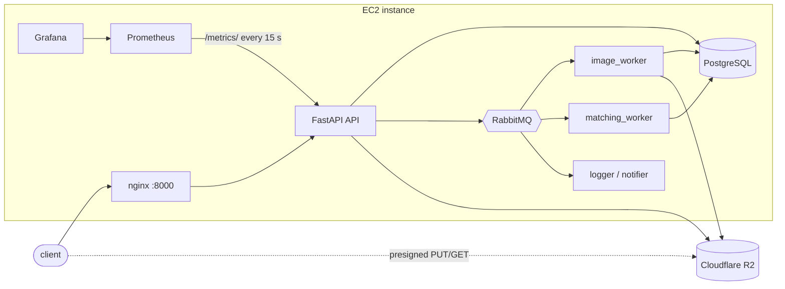
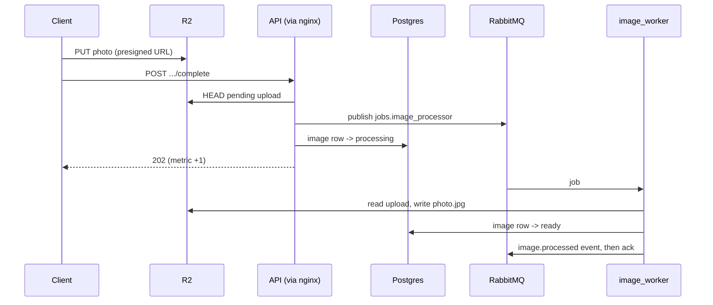

# Architecture

Campus Seekr is a lost-and-found API: people post lost or found items with a photo, and the system suggests
lost/found matches. The whole `compose.yml` stack runs on one EC2 instance (c7i-flex.large, us-east-2), with
Cloudflare R2 as the object store. Only `.env.local` differs from a local run, and the data path has no
`if cloud:` branch.

## The four services

| Service | How the app uses it |
|---|---|
| Object storage (R2, S3 API) | Photos are uploaded and downloaded with presigned URLs, straight to R2. The image worker re-encodes each upload. `/files` uploads go through the API. Each object's key, type and size is a row in `images` or `files` |
| Relational (PostgreSQL 16.6) | 9 tables, with foreign keys and check constraints enforced by Postgres |
| Messaging (RabbitMQ 3.13.7) | Durable queues `jobs.image_processor` and `jobs.item_matcher`, with the ack after the work. The topic exchange `seekr.events` feeds the logger and notifier |
| Metrics (Prometheus, Grafana) | `seekr_requests_total{method, route, status}`, where route is the matched template, plus the domain counters `seekr_items_posted_total` and `seekr_matches_confirmed_total` |

## Traced request: finishing a photo upload

`POST /items/18/images/50dde9dc-.../complete`, 2026-10-22 02:59:48 UTC. Full transcript:
`evidence/transcripts/06-end-to-end-trace.txt`.

| Step | Evidence (UTC) |
|---|---|
| HTTP in | nginx: `52eceaaee8ab874cc0a93a31aa0393fb "POST /api/v1/items/18/images/50dde9dc-.../complete" 202 rt=0.089` |
| Message published | `02:59:48.519 INFO:lostfound:Published image job for item 18` |
| 202 returned | `02:59:48.525 "POST .../complete HTTP/1.1" 202 Accepted` |
| Row written | `images`: `processed_at 02:59:48.847`, `status ready` |
| Object stored | R2: `items/18/50dde9dc-.../photo.jpg`, 22,118 bytes, `image/jpeg` |
| Consumer completed | `02:59:48.977 INFO Stored items/18/50dde9dc-.../photo.jpg`, `image.processed` in `events.jsonl` |
| Metric incremented | `seekr_requests_total{route="/items/{item_id}/images/{upload_id}/complete",status="202"}` went from 6.0 to 7.0 |
